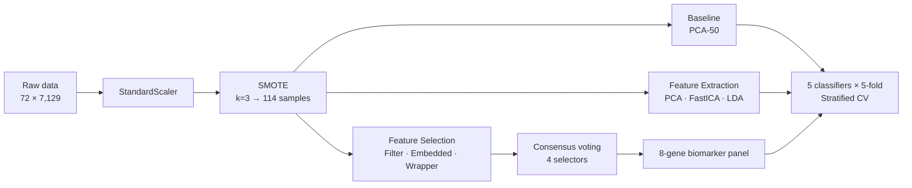

# 🧬 Leukemia 3-Subtype Classification — Optimised Feature Selection Pipeline

**Machine learning for rapid, low-cost triage of leukemia subtypes from gene expression data.**

> A decision-support tool, not a doctor-replacement: given a patient's microarray profile, the pipeline
> classifies **AML / B-cell ALL / T-cell ALL** in **< 1 second** using only **8 consensus gene biomarkers**,
> at **97.4% cross-validated accuracy** — enabling fast *dépistage* (screening) so that suspicious cases
> can be flagged for confirmatory clinical examination as early as possible.

---

## 📌 Why this matters

Leukemia subtype identification is clinically critical: treatment protocols and prognoses differ
substantially across AML, B-cell ALL and T-cell ALL. Full microarray profiling (7,129 gene probes)
is expensive, slow, and produces data no clinician can act on directly.

This project answers a concrete operational-research question:

> **Can we minimise the number of features measured and the computation time, while maximising
> classification performance — without sacrificing biological trustworthiness?**

The answer is yes: **8 genes, 0.45 s, 97.36% accuracy.**

Clinical positioning: this is a **triage/screening aid**, not a diagnostic replacement. When the model
strongly suggests a subtype, a standard clinical workup (e.g., MPO cytochemical stain, CD79A
immunostain, TCL1 assay) confirms it — potentially catching cases earlier and saving lives.

---

## 🗂️ Dataset

| Attribute | Value |
|---|---|
| Source | Golub et al. (1999) / Dudoit et al. (2002) — Leukemia 3C |
| Samples | 72 patient biopsies |
| Features | 7,129 Affymetrix gene expression probes |
| Classes | 3 — AML (25), B-cell ALL (38), T-cell ALL (9) |
| Challenge | **p ≫ n** (~100 features per sample), severe class imbalance (T-cell ALL = 12.5%) |
| After SMOTE (k=3) | 114 balanced samples (38 per class) |

## ⚙️ Experimental setup

## ⚙️ Pipeline



- **Evaluation:** 5-fold stratified cross-validation (fixed seed = 42), weighted Precision / Recall / F1
- **Preprocessing:** StandardScaler (zero mean, unit variance) → SMOTE class balancing
- **Classifiers:** Logistic Regression · Linear SVC · Random Forest (100 trees) · Gradient Boosting (80 trees) · KNN (k=7)

---

## 🔑 Key results

### 1. Baseline (all features, PCA-50 pre-reduction)

| Model | Accuracy | Precision | Recall | F1 |
|---|---|---|---|---|
| Random Forest | **99.09%** | 99.20% | 99.09% | 99.09% |
| Logistic Regression | 98.18% | 98.18% | 98.18% | 98.18% |
| Gradient Boosting | 95.61% | 96.18% | 95.61% | 95.58% |
| Linear SVC | 95.61% | 96.31% | 95.61% | 95.59% |
| KNN | 72.77% | 80.64% | 72.77% | 71.06% |

KNN's collapse in 7,129-dimensional space (all pairwise distances converge) is the textbook curse of
dimensionality — and the motivation for the entire feature-reduction effort.

### 2. Feature extraction vs. feature selection

| Method | Type | K | Best Accuracy | Runtime |
|---|---|---|---|---|
| PCA | Extraction | 15 | 94.70% | 2.35 s |
| FastICA | Extraction | 10 | 92.89% | 1.98 s |
| LDA | Extraction | 2 | 77.23% | 1.40 s |
| ANOVA F-test (f_classif) | Filter | 15 | 97.31% | **0.51 s** |
| Mutual Information | Filter | 15 | 96.48% | 89.46 s |
| **L1 Lasso Logistic Regression** | **Embedded** | **10** | **99.09%** | **0.45 s** |
| Random Forest importance | Embedded | 15 | 99.09% | 0.54 s |
| RFE + Logistic Regression | Wrapper | 10 | 99.09% | 2,165 s |
| RFE + Random Forest | Wrapper | 10 | 97.35% | 332 s |

Extraction methods underperform the best selection methods by ≈4 pp **and destroy gene identity** —
unusable for biomarker discovery. L1 Lasso matches the best wrapper accuracy **4,811× faster**.

### 3. Final consensus panel — 8 genes, 5-fold CV

| Model | Accuracy | Precision | Recall | F1 |
|---|---|---|---|---|
| **Logistic Regression** | **97.36%** | 97.41% | 97.36% | 97.35% |
| Linear SVC | 96.49% | 96.52% | 96.49% | 96.48% |
| Random Forest | 96.49% | 96.54% | 96.49% | 96.48% |
| Gradient Boosting | 94.74% | 94.82% | 94.74% | 94.72% |
| KNN | 92.98% | 93.16% | 92.98% | 92.90% |

> **476× fewer features for only −1.73 pp accuracy.** From a clinical standpoint, testing 8 genes is
> immeasurably more practical than profiling 7,129 simultaneously.

### 4. The headline: pipeline optimisation V1 → V3

| Metric | V1 (original) | V2 | V3 (final) | Gain |
|---|---|---|---|---|
| Best CV accuracy | 99.09% | 99.09% | 99.09% | **stable** |
| Feature count | 7,129 | 10 | 15 (8 for consensus) | 476× fewer |
| Total runtime | 4,783 s (~78 min) | 2,497 s | **0.45 s** | **1,166× faster** |

Three targeted changes, no accuracy loss:
1. **RFE moved outside the CV loop** (−40 min; was retraining 5× redundantly)
2. **Elbow scanning eliminated** — fixed K=15 instead of testing 7 values × 12 methods (−35 min; 360 redundant CV runs removed)
3. **SVM-RFE (446 s) replaced by L1 Lasso (0.45 s)** — same accuracy, 1,166× faster

---

## 🧬 Biological validation — the panel mirrors clinical diagnostic logic

Four independent selectors (f_classif, mutual info, L1, RF importance) voted on every gene.
The strong-consensus tier (≥3/4 votes) yielded 8 genes; the two unanimous genes are:

| Probe ID | Votes | Gene | Marker for | Clinical analogue |
|---|---|---|---|---|
| U23852_s_at | **4/4** | **CD79A** (Igα) | B-cell ALL | CD79A immunostain |
| U05259_rna1_at | **4/4** | **TCL1A** | T-cell ALL | TCL1 assay |
| D00749_s_at | 3/4 | **MPO** (Myeloperoxidase) | AML | MPO cytochemical stain |
| X00437_s_at | 3/4 | IgL / TCR (to confirm) | B/T-cell | — |
| X03934_at | 3/4 | IgL / TCR (to confirm) | B/T-cell | — |

**This is the strongest result of the project.** With no biological prior knowledge, the pipeline
independently rediscovered the exact three proteins haematologists test for in a manual leukemia
workup (MPO stain → CD79A stain → TCL1 assay). The model learned the clinician's diagnostic logic.

Consensus tiers: strict 4/4 → 2 genes · strong ≥3/4 → **8 genes (selected)** · moderate ≥2/4 → 17 genes (fallback).

---

## ⚠️ Honest limitations (100% accuracy is *not* the target)

- **p ≫ n regime:** with 7,129 features and 72 samples, perfect training accuracy is trivially achievable
  and says nothing about generalisation. The honest CV ceiling is **97–99%** — the figure to trust.
- **SMOTE placement:** SMOTE is applied before CV rather than strictly inside each fold, so reported
  metrics carry a small optimistic bias (a fully nested pipeline is provided in the report and would
  be the correct production deployment).
- **Small single dataset:** external validation on independent GEO cohorts (e.g., GSE28497) is the
  natural next step; conclusions about method ranking are dataset-specific.

---

## 🛠️ Tech stack

`Python` · `scikit-learn` · `imbal-learn (SMOTE)` · `pandas` · `numpy` · `matplotlib` · `seaborn`

## 📁 Repository contents

| File | Description |
|---|---|
| `dami2.ipynb` | Full interactive pipeline: preprocessing → baseline → extraction → selection → consensus voting → visualisations |
| `Leukemia_3c.csv` | Benchmark microarray dataset (72 samples × 7,129 gene expression probes) |
| `dami2_leukemia_report.pdf` | Full technical report (methods, maths, version evolution, biological mapping, references) |
| `leukemia_classification_presentation.pdf` | Defence slides summarising setup, results and recommendations |
| `results_summary.png` | Accuracy-per-method, baseline-vs-consensus, and vote-distribution charts |
| `requirements.txt` | Python package dependencies |

## ▶️ Quick start (recommended V3 pipeline)

```python
from sklearn.preprocessing import StandardScaler
from sklearn.linear_model import LogisticRegression
from sklearn.feature_selection import SelectFromModel
from imblearn.over_sampling import SMOTE

# 1. Standardise
X_sc = StandardScaler().fit_transform(X)

# 2. Balance classes
X_bal, y_bal = SMOTE(random_state=42, k_neighbors=3).fit_resample(X_sc, y)

# 3. Embedded selection — L1 Lasso (0.45 s, 99.09% CV accuracy)
l1 = LogisticRegression(penalty="l1", C=0.1, solver="liblinear",
                        max_iter=500, random_state=42).fit(X_bal, y_bal)
X_sel = SelectFromModel(l1, prefit=True, max_features=15).transform(X_bal)

# 4. Cross-validate
from sklearn.model_selection import StratifiedKFold, cross_validate
cv = StratifiedKFold(5, shuffle=True, random_state=42)
scores = cross_validate(LogisticRegression(), X_sel, y_bal, cv=cv,
                        scoring=["accuracy", "f1_weighted"])
```

For biomarker reporting, use the 8-gene consensus panel instead (≥3/4 selector agreement) —
multi-method consensus provides stronger biological evidence than any single selector.

## 🚀 How to run the project

**1. Clone the repository**
```bash
git clone https://github.com/wassim-lech/data-mining-project.git
cd data-mining-project
```

**2. Install dependencies(ngl i was too lazy to continue the set up just use kaggle like everyone 🥀)** 
```bash

```

**3. Launch the notebook**


> **Dataset path:** the notebook was developed on Kaggle, so the data-loading cell points to a Kaggle path.
> To run locally, change it to the CSV included in this repo:
> ```python
> df_raw = pd.read_csv("Leukemia_3c.csv")
> ```
> Prefer zero setup? Upload `dami2.ipynb` and `Leukemia_3c.csv` to [Kaggle](https://www.kaggle.com/) and run it there.

---

## 📚 References

1. Golub et al. (1999). *Molecular classification of cancer: class discovery and class prediction by gene expression monitoring.* Science, 286(5439).
2. Dudoit, Fridlyand & Speed (2002). *Comparison of discrimination methods for the classification of tumors using gene expression data.* JASA, 97(457). — introduced the 3-class split.
3. Chawla et al. (2002). *SMOTE: Synthetic Minority Over-sampling Technique.* JAIR, 16.
4. Guyon et al. (2002). *Gene selection for cancer classification using support vector machines.* Machine Learning, 46.
5. Tibshirani (1996). *Regression shrinkage and selection via the Lasso.* JRSS-B, 58.

---

*Academic project — Data Mining 2, Master 1 SDIA, University of Abdelhamid Mehri (Constantine 2), 2025–2026.*
*Authors: Roa Lalaoui · lecheb Mohamed Wassim-gotaga7 on ttv. Supervisor: Dr. Ghanem Khedoudja.*